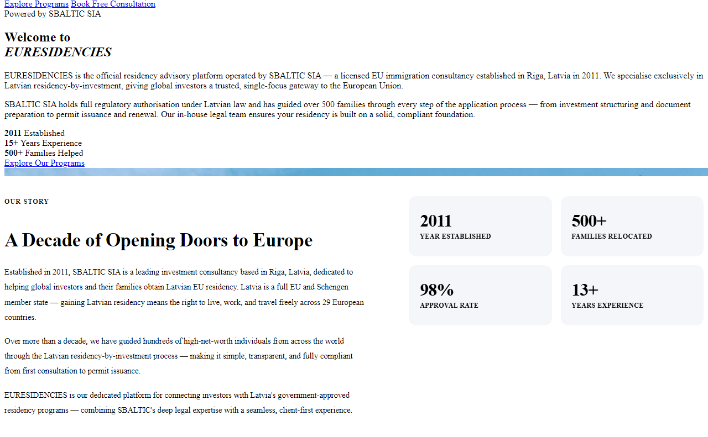
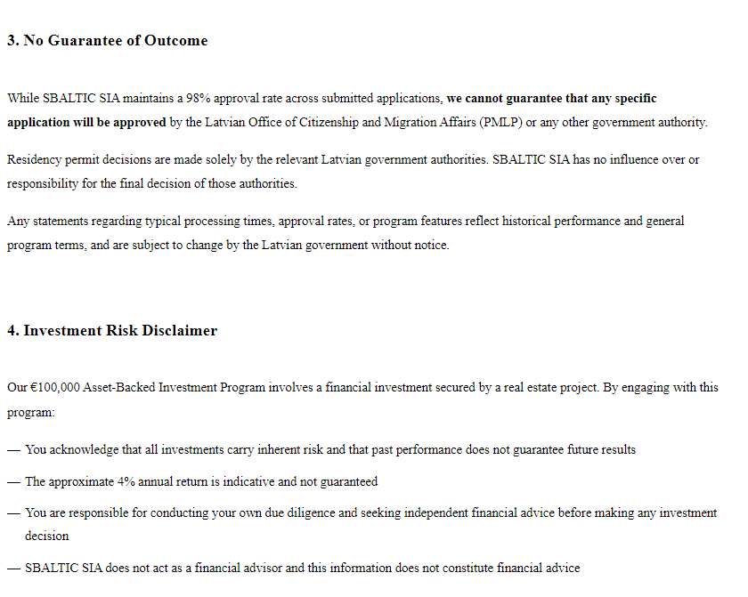
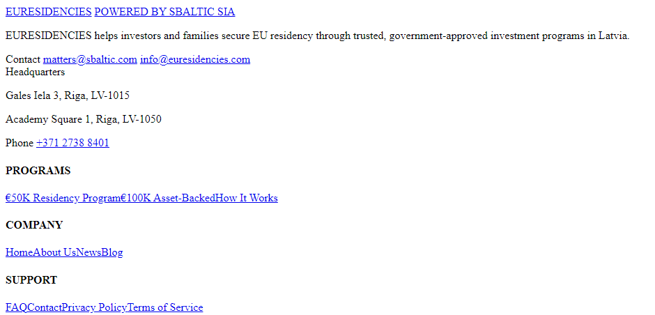
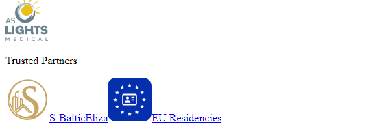

# Uzturēšanās atļauja par 50 000 €: ko saka S-Baltic portāls un ko rāda reģistri

**Avoti:** euresidencies.com, sbaltic.com, aslightsmedical.com, eilza.lv, Uzņēmumu reģistrs (UR), VID, Latvijas Banka, likumi.lv, LSM, LETA, NRA | **Dati uz:** 2026. gada 24. oktobri (S-BALTIC LV izraksts un aslightsmedical.com — 25. oktobrī, brošūra un latviagoldvisa.com — 27. oktobrī, KNAB un PMLP pārbaudes — 31. oktobrī, PMLP pirmie rezultāti, UR akcionāru dati un aslightsmedical.com pieejamība — 4. novembrī)

<aside class="post-brief" aria-label="Īsumā" markdown="1">

Īsumā

- Portālu euresidencies.com uztur SIA «S-BALTIC». Portāls piedāvā ārzemniekiem palīdzību iegūt Latvijas uzturēšanās atļauju par 50 000 € ieguldījumu uzņēmuma pamatkapitālā. Uzņēmuma vienīgais valdes loceklis ir Gerald Hoppstaedter.
- Portāls 24. oktobrī rakstīja, ka uzņēmums dibināts 2011. gadā, ir licencēts («licensed») un palīdzējis vairāk nekā 500 ģimenēm. Līdz 27. oktobrim šie apgalvojumi no portāla pamatteksta izņemti, un dibināšanas gads tagad ir 2013. Uzņēmumu reģistrā SIA «S-BALTIC» ierakstīta 2013. gadā. Gada pārskatos 2014.–2019. gadā tās apgrozījums bija 12 000–99 700 € gadā, bet kopš 2020. gada tas ir 0 €, un 2023.–2025. gadā tai nav neviena darbinieka. Pēc uzņēmuma lapas, juridisko darbu veic ārēju speciālistu tīkls.
- Kāda licence uzņēmumam ir un kas to izsniedza, portāls nenorāda. Latvijas Bankas finanšu tirgus dalībnieku reģistrā to neatradām.
- Kā vienu no divām galvenajām adresēm portāls 24. oktobrī norādīja Akadēmijas laukumu 1 — Zinātņu akadēmijas augstceltni. Tur reģistrēts arī SIA «Latvijas Zinātņu akadēmijas Ekonomikas institūts», kuru vada Ņina Linde.
- S-Baltic lapā Linde nosaukta par uzņēmuma vadītāju («Managing Director»). UR izrakstā (24. oktobrī) viņai S-BALTIC nav ne amata, ne prokūras, bet vadīt darbu var arī bez ieraksta reģistrā. Uzņēmuma starptautiskais koordinators pārzina attiecības ar portālu. Institūta lapā viņš norādīts kā IT speciālists.
- Portāls apraksta ieguldījumu uzņēmumā, kurā kopā iegulda 5–10 ārzemnieki un saņem B klases akcijas. Līdzīgs sastāvs ir AS «GTECH» un AS «LIGHTS». Pirmajā visas balsis pieder Hoppstaedter, otrajā — Lindei.
- Abās kopā ir 21 akcionārs ar akcijām par 50 000 € bez balsstiesībām. Diviem no viņiem uzturēšanās atļauja nav vajadzīga. Vai šie akcionāri ir portāla klienti, nezinām.
- Projekta lapā aslightsmedical.com 25. oktobrī tiem, kas nav ES pilsoņi, piedāvāja akciju bez balsstiesībām un atļaujas kārtošanu par kopumā 85 000 €. Lapā bija rakstīts, ka atļaujas lietas kārto S-Baltic un EU Residencies. Kura sabiedrība ir piedāvājuma puse — AS «LIGHTS» vai AS «LIGHTS Medical» —, precīzi nezinām. Vietne reģistrācijas numuru nenorādīja. Tas bija piedāvājums, nevis izsniegta atļauja. Vietnes vairs nav; lapas esam saglabājuši.
- PMLP aģentūrai LETA 3. novembrī norādīja, ka Linde un Hoppstaedter kā AS «LIGHTS» un AS «GTECH» amatpersonas 2018.–2026. gadā noformējuši 2 ielūgumus un 95 izsaukumus termiņuzturēšanās atļaujas pieprasīšanai personām no Indijas, Ķīnas un Vjetnamas. Izsaukums nav izsniegta atļauja, un LETA atstāstā nav teikts, ka pārkāpums būtu konstatēts. PMLP turpina sadarbību ar kompetentajām iestādēm, lai izvērtētu visus apstākļus.
- Plašāks konteksts — [Kas sagatavoja ziņas LZA ieteikumam?](/analizes/lza-ieteikums-ekonomikas-instituts-2026.html) un [Divas Saeimas pilsonības vienai ģimenei](/analizes/visvanati-pilsoniba-2026.html).
- Visas saites vienā skatā — [Izpētes tāfele](/analizes/saites-visvanati-2026.html)

</aside>

## Laika līnija

<ul class="tl-legend" aria-label="Apzīmējumi">
<li class="tl-in">Uzņēmumi un reģistri</li>

<li class="tl-lv">Portāls, likums un prese</li>
</ul>

<ol class="post-timeline">
<li class="tl-in"><time datetime="2013-01-21">2013. gada 21. janvāris</time>URRīgā reģistrēta SIA «S-BALTIC». Tās valdes priekšsēdētājs kopš šīs dienas ir Gerald Hoppstaedter. <a class="tl-src" href="https://info.ur.gov.lv/#/legal-entity/40103627136">UR</a></li>

<li class="tl-in"><time datetime="2017-11-27">2017. gada 27. novembris</time>URUR reģistrēts S-BALTIC dalībnieku saraksts: Hoppstaedter pieder 2849 no 2852 daļām. <a class="tl-src" href="https://info.ur.gov.lv/#/legal-entity/40103627136">UR</a></li>

<li class="tl-in"><time datetime="2018-05-28">2018. gada 28. maijs</time>URReorganizācija nodalīšanas ceļā: daļu S-BALTIC mantas, tiesību un saistību iegūst SIA «ECO TRADING». <a class="tl-src" href="https://www.vestnesis.lv/op/2018/28.KM4">Latvijas Vēstnesis</a></li>

<li class="tl-in"><time datetime="2020-08-10">2020. gada 10. augusts</time>URAS «GTECH» (Gāles iela 3) apmaksātais pamatkapitāls — 570 000 €. <a class="tl-src" href="https://data.gov.lv/dati/lv/dataset/equity-capitals">UR</a></li>

<li class="tl-lv"><time datetime="2021-08-03">2021. gada 3. augusts</time>PortālsReģistrēts domēns euresidencies.com. Arhīva kopijās līdz 2025. gada jūlijam tajā ir vienkārša lapa bez S-Baltic vārda, bet ar adresi Gāles iela 3. <a class="tl-src" href="https://web.archive.org/web/20250711091738/https://euresidencies.com/">arhīvs</a></li>

<li class="tl-in"><time datetime="2024-11-20">2024. gada 20. novembris</time>URGTECH akcionāru ieraksts: 10 akcionāriem katram akcijas par 50 000 € bez balsstiesībām. <a class="tl-src" href="https://data.gov.lv/dati/lv/dataset/stockholders">UR</a></li>

<li class="tl-lv"><time datetime="2024-12">2024. gada decembris</time>InstitūtsCilvēks, kurš tagad ir S-Baltic starptautiskais koordinators, jau ir LZA Ekonomikas institūta komandas lapas arhīva kopijā (kā «Developer»). <a class="tl-src" href="https://web.archive.org/web/20241206052450/https://eilza.lv/team">arhīvs</a></li>

<li class="tl-in"><time datetime="2025-11-13">2025. gada 13. novembris</time>URDatums AS «LIGHTS» akcionāru ierakstā: 11 akcionāriem katram akcijas par 50 000 € bez balsstiesībām. <a class="tl-src" href="https://data.gov.lv/dati/lv/dataset/stockholders">UR</a></li>

<li class="tl-in"><time datetime="2025-11-21">2025. gada 21. novembris</time>URReģistrēts LIGHTS apmaksātais pamatkapitāls — 585 000 €. <a class="tl-src" href="https://data.gov.lv/dati/lv/dataset/equity-capitals">UR</a></li>

<li class="tl-lv"><time datetime="2026-04-26">2026. gada 26. aprīlis</time>LSM«De facto»: Finanšu izlūkošanas dienests vairāk nekā 20 uzņēmumos saskata šķietami fiktīvus ieguldījumus uzturēšanās atļauju iegūšanai. GTECH un LIGHTS rakstā nav minēti. <a class="tl-src" href="https://www.lsm.lv/raksts/zinas/latvija/26.04.2026-finansu-izlukosanas-dienestam-aizdomas-par-zelta-vizu-shemam-vairak-neka-20-uznemumos.a644616/">LSM</a></li>

<li class="tl-lv"><time datetime="2026-06-13">2026. gada 13. jūnijs</time>PortālsArhīva kopijā euresidencies.com jau ir S-Baltic portāls ar «2011», «licensed» un «500 families». Kājenē ir tikai adrese Gāles iela 3. <a class="tl-src" href="https://web.archive.org/web/20260613052344/https://euresidencies.com/">arhīvs</a></li>

<li class="tl-lv"><time datetime="2026-09-15">2026. gada 15. septembris</time>LikumsStājas spēkā jaunais Imigrācijas likums. Uzturēšanās atļauja par 50 000 € ieguldījumu tajā saglabāta. <a class="tl-src" href="https://likumi.lv/ta/id/370622">likums</a></li>

<li class="tl-lv"><time datetime="2026-10-24">2026. gada 24. oktobris</time>PortālsPortāla kājenē ir divas galvenās adreses: Gāles iela 3 un Akadēmijas laukums 1. <a class="tl-src" href="/assets/sources/s-baltic-2026/euresidencies-kajene-2026-10-24.png">kopija 24.10.</a></li>

<li class="tl-lv"><time datetime="2026-10-25">2026. gada 25. oktobris</time>ProjektsLapa aslightsmedical.com tiem, kas nav ES pilsoņi, piedāvā akciju bez balsstiesībām par 85 000 € un sola uzturēšanās atļauju. Partneri — S-Baltic un EU Residencies. <a class="tl-src" href="/assets/sources/s-baltic-2026/aslightsmedical-izvilkumi-2026-10.png">kopija</a></li>

<li class="tl-lv"><time datetime="2026-10-27">2026. gada 27. oktobris</time>PortālsPortāla pamattekstā vairs nav «2011», «licensed», «500 families», 98 % un 100 000 € programmas, kājenē — Akadēmijas laukuma 1. aslightsmedical.com partneru joslā vairs nav «Eliza». <a class="tl-src" href="https://web.archive.org/web/20261027065458/https://euresidencies.com/about/">arhīvs 27.10.</a></li>
<li class="tl-lv"><time datetime="2026-10-29">2026. gada 29. oktobris</time>KNABKNAB sācis resorisko pārbaudi par iespējamām nelikumībām uzturēšanās atļauju iegūšanā; PMLP apstiprina, ka «Lights Medical» uzaicinājis trešo valstu pilsoņus. <a class="tl-src" href="https://www.lsm.lv/raksts/zinas/latvija/29.10.2026-knab-sacis-parbaudi-par-iespejamam-nelikumibam-uzturesanas-atlauju-iegusanas-procesa.a669760/">LSM/LETA</a></li>
<li class="tl-lv"><time datetime="2026-11-01">2026. gada 1. novembris</time>PortālsPortāls pārrakstīts vēlreiz: vairs nav Gerald Hoppstaedter vārda un piecu gadu atļaujas solījuma; sbaltic.com/counsel pāradresē uz sākumlapu. <a class="tl-src" href="https://web.archive.org/web/20261104150747/https://euresidencies.com/about/">arhīva kopija 4.11.</a></li>

<li class="tl-lv"><time datetime="2026-11-02">2026. gada 2. novembris</time>MinistrsIekšlietu ministrs raksta, ka caur firmām, kas pieder Lindei un abiem Hoppstaedter, noformēti «krietni virs simts izsaukumu un ielūgumu»; PMLP vēlas turpināt pārbaudes. <a class="tl-src" href="https://nra.lv/latvija/533538-dombrava-atklaj-pirmos-rezultatus-uzturesanas-atlauju-parbaude.htm">NRA</a></li>

<li class="tl-lv"><time datetime="2026-11-03">2026. gada 3. novembris</time>PMLPPMLP aģentūrai LETA: Linde un Hoppstaedter kā AS «LIGHTS» un AS «GTECH» amatpersonas 2018.–2026. gadā noformējuši 2 ielūgumus un 95 izsaukumus. Izsaukums nav izsniegta atļauja. <a class="tl-src" href="https://www.firmas.lv/lv/zinas/skatit/news6ae9f6f340082+uznemeji-linde-un-hopstedters-noformejusi-95-izsaukumus-tua-pieprasisanai-personam-no-indijas-kinas-un-vjetnamas">LETA, firmas.lv</a>, <a class="tl-src" href="https://web.archive.org/web/20261111075935/https://www.firmas.lv/lv/zinas/skatit/news6ae9f6f340082+uznemeji-linde-un-hopstedters-noformejusi-95-izsaukumus-tua-pieprasisanai-personam-no-indijas-kinas-un-vjetnamas">arhīvs</a></li>

<li class="tl-lv"><time datetime="2026-11-04">2026. gada 4. novembris</time>ProjektsVietne aslightsmedical.com ir noņemta. Kad, kas un kāpēc to izdarīja, nezinām. <a class="tl-src" href="/assets/sources/s-baltic-2026/aslightsmedical-izvilkumi-2026-10.png">mūsu kopija</a></li>
</ol>

## Ko piedāvā portāls

Portāla euresidencies.com virsraksts ir «Latvia Golden Visa — EU Residency by Investment from €50,000» — Latvijas «zelta vīza», ES uzturēšanās atļauja par ieguldījumu no 50 000 € ([euresidencies.com](https://euresidencies.com/)). Katras lapas augšā rakstīts «Powered by SBALTIC SIA». Portāla privātuma politikā un noteikumos norādīts reģistrācijas numurs 40103627136 ([privātuma politika](https://euresidencies.com/privacy/), [noteikumi](https://euresidencies.com/terms/)). Uzņēmumu reģistrā (UR) šis numurs pieder SIA «S-BALTIC» ([UR reģistrs](https://data.gov.lv/dati/lv/dataset/uz)). Tālāk SIA «S-BALTIC» ir juridiskā persona, bet S-Baltic — zīmols, ar kuru uzņēmums sevi sauc savās lapās.

Portāls piedāvā divas programmas:

- **50 000 €.** Ieguldījums uzņēmuma pamatkapitālā — naudā, ko dalībnieki iemaksā uzņēmumā apmaiņā pret akcijām vai daļām. Līdz atļaujai solīti «2 months», un dzīvot Latvijā nav obligāti ([programmas](https://euresidencies.com/programs/)). Lapā «How It Works» kopējās izmaksas vienam pieteicējam aprēķinātas ap 85 000 €. Tajās ir ieguldījums, 10 000 € valsts nodeva un 25 000 € «statutory costs & consulting fees», arī uzņēmuma atrašana («company matchmaking») ([How It Works](https://euresidencies.com/how-it-works/)).
- **100 000 €.** Ieguldījums, kas nodrošināts ar senioru un spa nekustamā īpašuma projektu («retirement & spa real estate project»). Norādītais ienesīgums ir ap 4 % gadā, bet noteikumos rakstīts, ka tas nav garantēts. Kurš ir šis projekts, portāls nenosauc ([noteikumi, kopija 24.10.](/assets/sources/s-baltic-2026/euresidencies-noteikumi-2026-10-24.png)). 27. oktobrī šīs programmas portālā vairs nav.

Lapā «How It Works» aprakstīti trīs ieguldījuma veidi. Otrais ir «growth company» — jaunāks uzņēmums, kurā kopā iegulda 5–10 ārzemnieki. Par to rakstīts: «Class B shareholding shields you from liabilities and management duties» — B klases akcijas atbrīvo no atbildības un vadības pienākumiem. Pats portāls raksta, ka iesaka pirmo veidu — sen strādājošu uzņēmumu.

Sīkāk un avoti

**Kas ir «SBALTIC SIA».** Hoppstaedter vada divus līdzīgi nosauktus uzņēmumus Rīgā, Gāles ielā 3: SIA «S-BALTIC» (40103627136) un SIA «S-BALTIC LV» (40203105037). Portāla noteikumi, privātuma politika un sbaltic.com kājene norāda pirmo numuru. SIA «S-BALTIC LV» [UR izrakstā](https://info.ur.gov.lv/#/legal-entity/40203105037), kas pārbaudīts 2026. gada 25. oktobrī, Hoppstaedter ir valdes priekšsēdētājs kopš 2018. gada 4. decembra un vienīgais dalībnieks kopš 2018. gada 23. novembra: viņam pieder visas 2800 daļas (100 %). SIA «S-BALTIC LV» ir atsevišķs uzņēmums ar apgrozījumu 36 000–53 000 € gadā (2019.–2025.) ([UR gada pārskatu dati](https://data.gov.lv/dati/lv/dataset/gada-parskatu-finansu-dati)).

**Kas pārzina attiecības ar portālu.** S-Baltic lapā portālu euresidencies.com sauc par uzņēmuma «dedicated immigration portal». Attiecības ar to pārzina uzņēmuma starptautiskais koordinators ([sbaltic.com/counsel, kopija 24.10.](/assets/sources/s-baltic-2026/sbaltic-counsel-2026-10-24.png)).

**Portāla vēsture.** Domēns euresidencies.com reģistrēts 2021. gada 3. augustā, sbaltic.com — 2013. gada 4. februārī (Verisign RDAP, pārbaudīts 24. oktobrī). Trijās pārbaudītajās arhīva kopijās no 2021. gada novembra līdz 2025. gada jūlijam euresidencies.com ir vienkārša WordPress lapa «Residency in the European Union – From 50.000 EUR + associated Expenses». S-Baltic vārda tajā nav, bet ir adrese Gāles iela 3. 2021. gada novembra kopijā rakstīts arī «You can be a member of the EU in 30 days!*» — iespēja kļūt par ES iedzīvotāju 30 dienās; zvaigznītes piezīmē minēti nosacījumi ([Wayback, 2021. gada novembris](https://web.archive.org/web/20211130130239/https://euresidencies.com/); [Wayback, 2025. gada jūlijs](https://web.archive.org/web/20250711091738/https://euresidencies.com/)).

Versija ar «2011», «licensed» un «500 families» ir jau kopijā no 2026. gada 13. jūnija ([Wayback](https://web.archive.org/web/20260613052344/https://euresidencies.com/)). Šajā kopijā kājenē ir tikai Gāles iela 3; Akadēmijas laukums 1 tur parādījies vēlāk.

**Portāla izmaiņas 27. oktobrī.** Laikā no 24. līdz 27. oktobrim portāls pārrakstīts. Dibināšanas gads «2011» nomainīts uz «2013». No lapu pamatteksta izņemti apgalvojumi «licensed» un «full regulatory authorisation», «500 families», apstiprināti 98 % pieteikumu («Approval Rate»), kā arī 100 000 € programma; sākumlapas attēla alternatīvajā tekstā saglabājies formulējums «licensed Latvia immigration advisors». Kājenē vairs nav adreses «Academy Square 1». Lapā sbaltic.com «Latvian & EU Legal Counsel» nomainīts uz «Immigration & Residency in Latvia». Projekta vietnes aslightsmedical.com partneru joslā vairs nav «Eliza» ar saiti uz LZA Ekonomikas institūta lapu.

Šīs versijas lapas saglabātas arhīvā; mūsu 27. un 31. oktobra kopijās euresidencies.com lapu pamatteksts sakrīt ([euresidencies.com, 27.10.](https://web.archive.org/web/20261027065429/https://euresidencies.com/), [About, 27.10.](https://web.archive.org/web/20261027065458/https://euresidencies.com/about/), [noteikumi, 31.10.](https://web.archive.org/web/20261031002213/https://euresidencies.com/terms/), [sbaltic.com](https://web.archive.org/web/20261027070457/https://sbaltic.com/), [aslightsmedical.com — mūsu kopija](/assets/sources/s-baltic-2026/aslightsmedical-partneri-2026-10-25-27.png)). 24. oktobra versiju rāda mūsu kopiju ekrānattēli ([par uzņēmumu](/assets/sources/s-baltic-2026/euresidencies-par-uznemumu-2026-10-24.png), [noteikumi](/assets/sources/s-baltic-2026/euresidencies-noteikumi-2026-10-24.png), [kājene](/assets/sources/s-baltic-2026/euresidencies-kajene-2026-10-24.png), [aslightsmedical.com partneri, 25.10.](/assets/sources/s-baltic-2026/aslightsmedical-partneri-2026-10-25.png)).

**Portāla izmaiņas 1. novembrī.** Laikā no 31. oktobra līdz 1. novembrim portāls pārrakstīts vēlreiz. Nevienā no 12 pārbaudītajām euresidencies.com un sbaltic.com lapām vairs nav Gerald Hoppstaedter vārda; lapā About izņemta sadaļa «Meet the Founder». Lapā «How It Works» «5-year EU residence permit, renewed annually» nomainīts uz «EU residence permit of up to 2 years», un pievienots, ka 15. septembrī stājies spēkā jaunais Imigrācijas likums. Lapā «How It Works» apgalvojums, ka Latvijā ir lētākā («cheapest») programma ES, nomainīts uz «one of the most affordable»; sākumlapā «cheapest» saglabājies. Lapā sbaltic.com vairs nav sadaļas «Counsel» un skaitļu «13+ years» un «120+ cases»; dibināšanas gads «2013» palicis. Adrese sbaltic.com/counsel pāradresē uz sākumlapu.

Arhīva kopijas: [sbaltic.com](https://web.archive.org/web/20261101094328/https://sbaltic.com/) (1. novembrī), [How It Works](https://web.archive.org/web/20261104215736/https://euresidencies.com/how-it-works/), [euresidencies.com](https://web.archive.org/web/20261104153608/https://euresidencies.com/), [About](https://web.archive.org/web/20261104150747/https://euresidencies.com/about/) (visas 4. novembrī; šo trīs lapu kopijas ar 1. novembra datumu arhīvā vairs neatveras). Izmaiņu laiku nosakām pēc mūsu 31. oktobra un 1. novembra kopijām; 4. novembra arhīva kopijas rāda vēlāko stāvokli. Mūsu 1. novembra lapas About kopijas SHA-256: `c2aa0c6c5d5cffc49489199263d33844f02bfbcce3153b6defdcb5acab155fca`. Iepriekšējo versiju rāda 27. oktobra kopijas: rindkopā augstāk un [How It Works, 27.10.](https://web.archive.org/web/20261027065924/https://euresidencies.com/how-it-works/).

**Mūsu kopijas.** Visas citētās portāla un sbaltic.com lapas lejupielādējām 2026. gada 24. oktobrī. Galvenās lapas SHA-256: euresidencies.com — `4008520aaafc8b5786c0ec7dba399522ba38364be084a107151016c9f9bb5b8a`, sbaltic.com/counsel — `0c1998d67789a020a160dc58d5ff2275951e67aadd70729026c675bee30edff9`. Divās lejupielādēs 24. oktobrī abas lapas bija identiskas. Lapa sbaltic.com/counsel vēlāk mainīta: 2026. gada 26. oktobrī no iepriekš nosauktajiem komandas cilvēkiem palicis tikai Gerald Hoppstaedter, bez Ņinas Lindes un starptautiskā koordinatora ([arhīva kopija 26.10. plkst. 01.53 pēc Latvijas laika](https://web.archive.org/web/20261025235358/https://sbaltic.com/counsel/); mūsu 27. un 31. oktobra kopijās pamatteksts sakrīt, 1. novembrī adrese pāradresē uz sākumlapu). Wayback Machine pašreizējā indeksā agrāku šīs lapas kopiju neatradām.

Neatkarīgais tīmekļa arhīvs Common Crawl lapu saglabāja 2026. gada 15. augustā: tajā Ņina Linde ir «Managing Director», bet starptautiskais koordinators «manages the relationship with S‑Baltic's dedicated immigration portal, euresidencies.com» ([Common Crawl indekss](https://index.commoncrawl.org/CC-MAIN-2026-34-index?url=sbaltic.com/counsel/&output=json), ieraksts 2026-08-15 21:28:51 UTC). Lapas izskatu 24. oktobrī rāda [mūsu kopijas ekrānattēls](/assets/sources/s-baltic-2026/sbaltic-counsel-2026-10-24.png).

## Portāls saka, reģistri rāda

| | Portāls euresidencies.com un sbaltic.com | Reģistri un pašu dokumenti |
|---|---|---|
| Dibināšana | «established in Riga, Latvia in 2011»; «Gerald established SBALTIC in 2011» | UR: reģistrēts 2013. gada 21. janvārī. sbaltic.com lapā: «S‑Baltic SIA — Est. 2013» |
| Pieredze | vienā un tajā pašā lapā «15+ Years Experience» un «13+ Years Experience» | Lapā nav paskaidrots, kāpēc skaitļi atšķiras |
| Apjoms | «guided over 500 families»; «Our in-house legal team» | gada pārskati: apgrozījums 2020.–2025. gadā — 0 €; darbinieku 2023.–2025. gadā — 0. Portāla noteikumi: «We are not a law firm»; sbaltic.com: juridisko darbu veic ārēju speciālistu tīkls |
| Licence | «a licensed EU immigration consultancy»; «holds full regulatory authorisation under Latvian law» | licence un tās izdevējs nav nosaukti; Latvijas Bankas reģistrā neatradām (24. oktobrī) |
| Rezultāti | apstiprināti 98 % pieteikumu («Approval Rate») | PMLP: 2025. gadā par ieguldījumu pamatkapitālā iesniegti 109 pieteikumi, pozitīvs lēmums — ap trešdaļai (dati par visiem pieteicējiem, ne tikai S-Baltic klientiem). Šos datus atkārto arī pats portāls (sk. «PMLP skaitļi») |
| Vadība | Ņina Linde — «Managing Director» | UR izrakstā (24. oktobrī) S-BALTIC vienīgā amatpersona ir Gerald Hoppstaedter; prokūra nav ierakstīta. Linde nav ne dalībniece, ne patiesā labuma guvēja. Vadīt darbu var arī bez ieraksta reģistrā |

Tabula liek blakus to, kas rakstīts portālā, un to, kas ierakstīts reģistros. Katrai rindai var būt skaidrojums, ko dati nerāda: darbu var veikt ārēji speciālisti, uzņēmumam var būt atļauja, kuras nav Latvijas Bankas reģistrā, un 98 % attiecas uz citu pieteikumu kopu nekā PMLP skaitļi. Sīkāk — zemāk un sadaļā «Ko mēs neapgalvojam».

Avoti: [euresidencies.com](https://euresidencies.com/), [About](https://euresidencies.com/about/), [portāla kopija 24.10.](/assets/sources/s-baltic-2026/euresidencies-par-uznemumu-2026-10-24.png), [FAQ](https://euresidencies.com/faq/), [noteikumi](https://euresidencies.com/terms/), [noteikumu kopija 24.10.](/assets/sources/s-baltic-2026/euresidencies-noteikumi-2026-10-24.png), [sbaltic.com](https://sbaltic.com/), [sbaltic.com/counsel (kopija 24.10.)](/assets/sources/s-baltic-2026/sbaltic-counsel-2026-10-24.png); [UR reģistrs](https://data.gov.lv/dati/lv/dataset/uz), [UR amatpersonas](https://data.gov.lv/dati/lv/dataset/officers), [UR dalībnieki](https://data.gov.lv/dati/lv/dataset/members), [UR gada pārskatu dati](https://data.gov.lv/dati/lv/dataset/gada-parskatu-finansu-dati); [Latvijas Bankas reģistrs](https://www.bank.lv/finansu-tirgus-dalibnieku-registrs/tirgus-dalibnieki); PMLP dati — [LSM](https://www.lsm.lv/raksts/zinas/latvija/26.04.2026-finansu-izlukosanas-dienestam-aizdomas-par-zelta-vizu-shemam-vairak-neka-20-uznemumos.a644616/).

Kā portāls izskatījās 24. oktobrī — 4 ekrānattēli no mūsu kopijām

Šo tekstu portālā 27. oktobrī vairs nav (sk. «Portāla izmaiņas 27. oktobrī» sadaļā «Sīkāk un avoti» zemāk). Attēli uzņemti no lapām, ko lejupielādējām 24. oktobrī (aslightsmedical.com — 25. oktobrī). Daļai lapu servera stils vairs nav pieejams, tāpēc tās rādītas bez noformējuma; teksts ir tas pats. Attēlu var palielināt, uzklikšķinot.

Tabulā izmantoti UR atvērtie dati — Uzņēmumu reģistra datu kopas, ko ikviens var lejupielādēt portālā data.gov.lv. Prokūrists ir persona, kurai uzņēmums devis tiesības to pārstāvēt darījumos. Patiesā labuma guvējs ir cilvēks, kuram uzņēmums faktiski pieder vai kurš to kontrolē. PMLP ir Pilsonības un migrācijas lietu pārvalde, kas lemj par uzturēšanās atļaujām.

Portāla noteikumos (2. punktā) rakstīts: «SBALTIC SIA provides advisory services only. We are not a law firm and do not provide legal representation.» Tas nozīmē: uzņēmums sniedz tikai konsultācijas, nav juristu birojs un klientus juridiski nepārstāv. Noteikumu 4. punktā par 100 000 € programmu 24. oktobrī bija rakstīts ([kopija](/assets/sources/s-baltic-2026/euresidencies-noteikumi-2026-10-24.png)), ka uzņēmums «does not act as a financial advisor» — nav finanšu konsultants. sbaltic.com lapā rakstīts, ka juridisko darbu veic ārējs speciālistu tīkls: «The legal work itself is carried out by a network of external specialists» ([sbaltic.com/counsel](https://sbaltic.com/counsel/)).

Sīkāk un avoti

**S-BALTIC finanses.** Uzņēmuma gada pārskatos ([UR gada pārskatu dati](https://data.gov.lv/dati/lv/dataset/gada-parskatu-finansu-dati), lejupielādēti 24. oktobrī):

| Gads | Apgrozījums, € | Peļņa vai zaudējumi, € | Pašu kapitāls, € | Darbinieki |
|---|---|---|---|---|
| 2014 | 62 569 | 36 318 | 89 541 | 5 |
| 2015 | 43 390 | −21 297 | 123 849 | 4 |
| 2016 | 99 700 | −93 996 | 66 552 | 7 |
| 2017 | 12 000 | −58 614 | 7 938 | 11 |
| 2018 | 67 945 | −46 813 | −78 156 | 5 |
| 2019 | 23 750 | −41 460 | −119 616 | 1 |
| 2020 | 0 | 6 569 | −113 047 | 1 |
| 2021 | 0 | 680 | −112 367 | 1 |
| 2022 | 0 | −1 042 | −113 409 | 1 |
| 2023 | 0 | −4 187 | −117 596 | 0 |
| 2024 | 0 | −18 511 | −136 107 | 0 |
| 2025 | 0 | −50 | −136 157 | 0 |

Uzņēmuma aktīvi 2025. gada beigās bija 0 €. VID datos S-BALTIC 2023. gadā samaksāja 10 560 € nodokļu, 2024. gadā — 0 € ([VID nodokļu dati](https://data.gov.lv/dati/lv/dataset/komersantu-ieprieksejos-tris-taksacijas-gados-samaksato-vid-administreto-nodoklu-kopsummas)). VID reitingā uzņēmums 6. oktobrī bija «N — neaktīvs nodokļu maksātājs» ([VID reitings](https://data.gov.lv/dati/lv/dataset/nodoklu-maksataju-reitings)). 2014.–2019. gadā uzņēmumam bija apgrozījums, un darbinieki pārskatos norādīti līdz 2022. gadam (sk. tabulu; 2013. gada pārskats ir latos, tāpēc tabulā nav iekļauts). Ja pakalpojumus sniedz ārēji speciālisti, darbinieku trūkums vēl nenozīmē, ka darbības nav. Kurš uzņēmums saņem samaksu par portāla pakalpojumiem, publiskie dati nerāda.

**Dalībnieki un vadība.** UR datos Hoppstaedter pieder 2849 no 2852 daļām; vēl trīs privātpersonām pieder pa vienai daļai. [UR izrakstā](https://info.ur.gov.lv/#/legal-entity/40103627136) (24. oktobrī) viņš valdes priekšsēdētāja amatā iecelts 2013. gada 21. janvārī, tātad uzņēmuma reģistrācijas dienā; ieraksts reģistrēts 2017. gada 27. novembrī. Citu amatpersonu un prokūras izrakstā nav.

**ECO TRADING.** 2018. gada 28. maijā UR reģistrēja S-BALTIC reorganizāciju nodalīšanas ceļā. Pēc «Latvijas Vēstnesī» 8. februārī publicētā paziņojuma S-BALTIC ir sadalāmā sabiedrība: daļa no tās mantas, tiesībām un saistībām nodota SIA «ECO TRADING», bet S-BALTIC turpina pastāvēt ([Latvijas Vēstnesis, 2018, Nr. 28](https://www.vestnesis.lv/op/2018/28.KM4)). UR izrakstos šis ieraksts formulēts īsi: S-BALTIC izrakstā — «Nodalīšanas ceļā pievienota daļa no SIA ECO TRADING», ECO TRADING izrakstā — «Sadalīta nodalīšanas ceļā» ar norādi uz S-BALTIC ([UR izraksts](https://info.ur.gov.lv/#/legal-entity/40103627136), [UR izraksts](https://info.ur.gov.lv/#/legal-entity/40103989618)). ECO TRADING reģistrēts 2016. gadā Gāles ielā 3; kopš 2019. gada tā valdes priekšsēdētāja un patiesā labuma guvēja ir Ņina Linde ([UR amatpersonas](https://data.gov.lv/dati/lv/dataset/officers), [UR patiesie labuma guvēji](https://data.gov.lv/dati/lv/dataset/patiesie-labuma-guveji)). Kas ECO TRADING vadīja 2018. gadā, atvērtie dati nerāda.

Salīdzinot 2017. un 2018. gada beigu bilances, S-BALTIC pamatlīdzekļi samazinājās no 109 852 € līdz 7 264 €, bet ECO TRADING pamatlīdzekļi pieauga no 0 € līdz 99 800 €, un tās saistības — no 94 € līdz 101 585 € ([UR gada pārskatu dati](https://data.gov.lv/dati/lv/dataset/gada-parskatu-finansu-dati)). Šīs izmaiņas sakrīt ar reorganizācijas virzienu, taču kādi tieši aktīvi vai saistības tika nodoti, publiskie dati nerāda.

**Licence.** Latvijas Bankas finanšu tirgus dalībnieku reģistra meklētājā 24. oktobrī meklējām «S-BALTIC», «S-Baltic», «SBALTIC», «EURESIDENCIES» un «Hoppstaedter». Neviens rezultāts nebija S-BALTIC, EURESIDENCIES vai Hoppstaedter; meklētājs atgrieza tikai citus uzņēmumus ar vārdu «Baltic» nosaukumā. Imigrācijas likumā konsultantu licence nav minēta. Vai uzņēmumam ir kāda cita atļauja, jautāsim pašam uzņēmumam. Tas, ka reģistrā neatradām, nepierāda, ka atļaujas nav.

**PMLP skaitļi.** LSM, atsaucoties uz PMLP datiem, ko pieprasīja «De facto», raksta: «Pērn iesniegti 109 pieteikumi […] Vienlaikus pozitīvs lēmums pieņemts vien aptuveni trešdaļā gadījumu.» Pēc LSM, kopumā šajā kārtībā atļauju saņēmusi 341 persona — investori un viņu ģimenes locekļi; par kādu periodu, LSM nenorāda ([LSM](https://www.lsm.lv/raksts/zinas/latvija/26.04.2026-finansu-izlukosanas-dienestam-aizdomas-par-zelta-vizu-shemam-vairak-neka-20-uznemumos.a644616/)).

Portāls 16. jūlijā publicēja šī LSM raksta kopsavilkumu. Tajā atkārtoti PMLP dati, ka pozitīvs lēmums bijis ap trešdaļai pieteikumu («only about a third»). Portāla lapā «About» tajā pašā laikā ir šāds apgalvojums:

> «98% Approval Rate» ([About, kopija 24.10.](/assets/sources/s-baltic-2026/euresidencies-par-uznemumu-2026-10-24.png); 27. oktobrī portālā vairs nav).

Portāla klientu pieteikumi un visi PMLP pieteikumi nav viena datu kopa; skaitļiem nav norādīts vienāds periods. Arī portāla apgalvojums par vairāk nekā 500 ģimenēm nav tieši salīdzināms ar PMLP minēto 341 personu: atšķiras mērvienība, un portāls nenosauc periodu un atļauju veidus, uz kuriem attiecas tā skaitlis. No šiem datiem nevar noteikt, vai portāla apgalvojums ir patiess.

Kopsavilkumā arī rakstīts, ka atteikumi skar «shell structures with no turnover, no employees, and no real activity» — uzņēmumus bez apgrozījuma, darbiniekiem un reālas darbības ([euresidencies.com](https://euresidencies.com/news/latvia-golden-visa-renewed-scrutiny/)).

## Akadēmijas laukums 1 un institūts

Katras portāla lapas apakšā sadaļā «Headquarters» 24. oktobrī bija divas adreses: «Gales Iela 3, Riga» un «Academy Square 1, Riga, LV-1050» ([kopija 24.10.](/assets/sources/s-baltic-2026/euresidencies-kajene-2026-10-24.png)). 27. oktobrī kājenē šīs adreses vairs nav. Akadēmijas laukums 1 ir Zinātņu akadēmijas augstceltne. Šajā adresē reģistrēts arī SIA «Latvijas Zinātņu akadēmijas Ekonomikas institūts» (turpmāk — LZA Ekonomikas institūts) ([UR reģistrs](https://data.gov.lv/dati/lv/dataset/uz)). LZA ir Latvijas Zinātņu akadēmija. Kopā šajā ēkā reģistrēti vairāk nekā 80 aktīvu uzņēmumu un organizāciju, no tiem 42 ar tieši šo adresi bez telpas numura. S-BALTIC juridiskā adrese UR ir Gāles iela 3.

Ar šo institūtu saistīti visi trīs S-Baltic komandas cilvēki, kurus 24. oktobrī nosauca sbaltic.com ([sbaltic.com/counsel, kopija 24.10.](/assets/sources/s-baltic-2026/sbaltic-counsel-2026-10-24.png)):

- **Gerald Hoppstaedter** — S-Baltic «CEO & Founder». Institūta komandas lapā viņš ir «Advisor to the Chairperson of the Board» — valdes priekšsēdētājas padomnieks ([eilza.lv](https://web.archive.org/web/20261024093156/https://eilza.lv/team)).
- **Ņina Linde** — S-Baltic lapā «Managing Director», kas vada ikdienas darbu. UR datos viņa ir institūta valdes priekšsēdētāja kopš 2014. gada ([UR amatpersonas](https://data.gov.lv/dati/lv/dataset/officers)). Tā viņa nosaukta arī institūta komandas lapā.
- **Starptautiskais koordinators** — S-Baltic lapā viņa darbs ir imigrācijas un uzturēšanās atļauju lietas, starptautiski ieguldījumi un attiecības ar portālu euresidencies.com. Institūta komandas lapā viņš norādīts kā «IT Specialist» — IT speciālists. 2024. gada decembra kopijā viņš ir «Developer», programmētājs ([eilza.lv, 2024](https://web.archive.org/web/20241206052450/https://eilza.lv/team)).

Vai un kā institūts un S-Baltic sadarbojas, publiskie dati nerāda. Institūts ir atsevišķs uzņēmums, nevis pati Akadēmija; LZA pieder 45 % tā daļu. Institūta lomu Divjas Kananas Višvanatas pilsonības lietā aprakstām rakstā [Kas sagatavoja ziņas LZA ieteikumam?](/analizes/lza-ieteikums-ekonomikas-instituts-2026.html)

## GTECH un LIGHTS: akcijas bez balsstiesībām par 50 000 €

Divās akciju sabiedrībās, kas saistītas ar Hoppstaedter un Lindi, ir akcionāru sastāvs, līdzīgs tam, ko portāls apraksta kā «growth company» ([UR akcionāri](https://data.gov.lv/dati/lv/dataset/stockholders)). Akcija bez balsstiesībām dod daļu kapitālā, bet ne balsi uzņēmuma lēmumos. UR izrakstos GTECH šīs akcijas sauktas par «“A” kategorijas priekšrocību akcijām bez balsstiesībām», LIGHTS — par «priekšrocību akcijām bez balsstiesībām»; «B» klase nevienā nav minēta.

- **AS «GTECH»** (Gāles iela 3). Hoppstaedter pieder 70 000 akciju un visas balsis; viņš ir arī valdes priekšsēdētājs. Vēl 10 akcionāriem katram ir 50 000 akciju bez balsstiesībām. Apmaksātais pamatkapitāls — 570 000 € ([UR pamatkapitāls](https://data.gov.lv/dati/lv/dataset/equity-capitals)). Apgrozījums 2021.–2025. gadā — 0 € katru gadu.
- **AS «LIGHTS»** (Salaspils pagasts). Lindei pieder 35 000 akciju un visas balsis; viņa ir arī valdes priekšsēdētāja. Vēl 11 akcionāriem katram ir 50 000 akciju bez balsstiesībām, un viens no viņiem ir Hoppstaedter. Apmaksātais pamatkapitāls — 585 000 €. Apgrozījums 2023.–2025. gadā — 0 € katru gadu, aktīvi 2025. gada beigās — 1,19 miljoni eiro.

Abiem uzņēmumiem ir darbinieki un nodokļu maksājumi. Gada pārskatos 2023.–2025. gadā katram ir 5 darbinieki; VID datos GTECH ir 4, LIGHTS — 5. Abi 2023. un 2024. gadā samaksāja ap 40 000 € nodokļu gadā ([UR gada pārskatu dati](https://data.gov.lv/dati/lv/dataset/gada-parskatu-finansu-dati), [VID nodokļu dati](https://data.gov.lv/dati/lv/dataset/komersantu-ieprieksejos-tris-taksacijas-gados-samaksato-vid-administreto-nodoklu-kopsummas)).

Kopā abos uzņēmumos ir 21 akcionārs ar akcijām par 50 000 € bez balsstiesībām. Tieši tik liels ieguldījums uzņēmuma pamatkapitālā ļauj ārzemniekam pieprasīt uzturēšanās atļauju. Par ieguldījumu vienā uzņēmumā šādu atļauju var saņemt ne vairāk kā 10 ārzemnieki ([Imigrācijas likums](https://likumi.lv/ta/id/370622), 27. panta 1. daļas 10. punkts).

Diviem no 21 akcionāra atļauja nav vajadzīga. Hoppstaedter ir Austrijas, tātad ES pilsonis ([UR patiesie labuma guvēji](https://data.gov.lv/dati/lv/dataset/patiesie-labuma-guveji)). Kanans Višvanats ir Latvijas pilsonis kopš 2023. gada. Sīkāk par abiem uzņēmumiem — [Divas Saeimas pilsonības vienai ģimenei](/analizes/visvanati-pilsoniba-2026.html).

Portāls nenosauc nevienu uzņēmumu, kurā tā klienti iegulda. Vai GTECH vai LIGHTS akcionāri ir portāla klienti un vai kāds no viņiem par šo ieguldījumu saņēma uzturēšanās atļauju, mēs nezinām. PMLP LETA nosauca noformēto izsaukumu skaitu, bet rakstā nav norādīts izsniegto atļauju skaits vai tas, kuriem akcionāriem šie izsaukumi noformēti.

### Projekta lapa: akcija par 85 000 €

Rehabilitācijas, spa un senioru mājokļu centra «LIGHTS Medical» vietne aslightsmedical.com norādīja, ka projekts top Spuņciemā, Mārupes novadā. Komandā bija minēti Linde un Hoppstaedter ([sākumlapa, kopija 25.10.](/assets/sources/s-baltic-2026/aslightsmedical-izvilkumi-2026-10.png)). Vietne lietoja divus nosaukumus — «AS Lights» un «AS Lights Medical» — un nenorādīja uzņēmuma reģistrācijas numuru. UR ir abas šādi nosauktas sabiedrības; kura ir piedāvājuma puse, precīzi nezinām (sk. «Sīkāk un avoti»).

Vietne piedāvāja akciju bez balsstiesībām un atļaujas kārtošanu par kopumā 85 000 €. Pēc tās cenu sadalījuma 50 000 € bija ieguldījums akcijā, 10 000 € — valsts nodeva, bet 25 000 € — pieteikuma, konsultāciju un citas maksas. Tā solīja piecu gadu uzturēšanās atļauju visai ģimenei un norādīja, ka akcija gada ienākumu nedod. Pēc vietnes teiktā, naudu varēja atgūt, pēc pieciem gadiem akciju pārdodot. ES pilsoņiem šo akciju nepiedāvāja: «Not offered (no value without residency)» — bez uzturēšanās atļaujas tai nav vērtības ([«Invest», kopija 25.10.](/assets/sources/s-baltic-2026/aslightsmedical-izvilkumi-2026-10.png)).

Atļauju lietas pēc vietnes ziņām kārtoja S-Baltic un EU Residencies. S-Baltic tā nosauca par sadarbības partneri juridiskajos un uzturēšanās atļauju jautājumos ([«Residency», kopija 27.10.](/assets/sources/s-baltic-2026/aslightsmedical-izvilkumi-2026-10.png)). Partneru joslā 25. oktobrī bija S-Baltic, EU Residencies un «Eliza». Saite pie vārda «Eliza» veda uz eilza.lv — LZA Ekonomikas institūta lapu ([kopija 25.10.](/assets/sources/s-baltic-2026/aslightsmedical-partneri-2026-10-25.png)). 27. oktobrī «Eliza» joslā vairs nav ([mūsu kopijas 25. un 27.10.](/assets/sources/s-baltic-2026/aslightsmedical-partneri-2026-10-25-27.png)).

Atļauju izsniedz valsts, izvērtējot likumā noteiktos nosacījumus. Pašreizējais likums paredz atļauju līdz diviem gadiem, bet vietne solīja piecus (sk. «Ko prasa likums» zemāk). Piedāvājums neparāda, kā akcijas ieguva 11 LIGHTS akcionāri bez balsstiesībām un vai kāds no viņiem saņēma atļauju. Lapas skatījām 2026. gada 25. oktobrī. 31. oktobrī vietne vairs nedarbojās: domēnā bija hostinga sagataves lapa, bet lapas «Invest» un «Residency» atgrieza kļūdu 404. 4. novembrī sākumlapa un abas šīs lapas vairs neatvērās. Vietne ir noņemta; kad, kas un kāpēc to izdarīja, nezinām. Piedāvājumu aprakstām pēc mūsu kopijām.

**Iestāžu pārbaudes.** LSM 29. oktobrī ziņoja, ka iekšlietu ministrs [Jānis Dombrava](/politiki/janis-dombrava.html) uzdevis PMLP un Finanšu izlūkošanas dienestam pārbaudīt publisko informāciju par Gerald Hoppstaedter, Doris Hoppstaedter un Ņinas Lindes iesaisti uzturēšanās atļauju iegūšanā. KNAB sācis resorisko pārbaudi un saņēmis iesniegumus. PMLP apstiprināja, ka uzņēmums «Lights Medical» ir uzaicinājis trešo valstu pilsoņus, un šīs atļaujas pārbaudīs atkārtoti; pirmos rezultātus tā gaidīja novembra pirmās nedēļas sākumā ([LSM/LETA](https://www.lsm.lv/raksts/zinas/latvija/29.10.2026-knab-sacis-parbaudi-par-iespejamam-nelikumibam-uzturesanas-atlauju-iegusanas-procesa.a669760/)). PMLP atbildes atstāstā uzņēmuma reģistrācijas numurs nav norādīts, tāpēc nevar droši noteikt, uz kuru no abām sabiedrībām («AS Lights» vai «AS Lights Medical») tas attiecas. Pārbaudes sākums nav pārkāpuma konstatējums.

**PMLP pirmie rezultāti.** Dombrava 2. novembrī «Facebook» rakstīja, ka caur šo personu firmām laika gaitā noformēti «krietni virs simts izsaukumu un ielūgumu ārzemniekiem» un ka PMLP vēlas turpināt pārbaudes, lai saprastu, vai nav saskatāmas noziedzīga nodarījuma pazīmes. Precīzu skaitu, laikposmu un uzņēmumus viņš nenosauca ([NRA](https://nra.lv/latvija/533538-dombrava-atklaj-pirmos-rezultatus-uzturesanas-atlauju-parbaude.htm)). 3. novembrī LETA no PMLP noskaidroja, ka Linde un Hoppstaedter kā AS «Lights» un AS «Gtech» amatpersonas 2018.–2026. gadā noformējuši divus ielūgumus un 95 izsaukumus termiņuzturēšanās atļaujas pieprasīšanai saistībā ar ieguldījumiem pamatkapitālā personām no Indijas, Ķīnas un Vjetnamas. PMLP turpina sadarbību ar kompetentajām iestādēm ([LETA, firmas.lv](https://www.firmas.lv/lv/zinas/skatit/news6ae9f6f340082+uznemeji-linde-un-hopstedters-noformejusi-95-izsaukumus-tua-pieprasisanai-personam-no-indijas-kinas-un-vjetnamas), [arhīva kopija 11.11.](https://web.archive.org/web/20261111075935/https://www.firmas.lv/lv/zinas/skatit/news6ae9f6f340082+uznemeji-linde-un-hopstedters-noformejusi-95-izsaukumus-tua-pieprasisanai-personam-no-indijas-kinas-un-vjetnamas)). Avoti tvērumu apraksta atšķirīgi: ministrs runā par trim personām piederošām firmām, bet PMLP atstāstā nosauktas divas amatpersonas un divi uzņēmumi. Vai abu ziņu tvērums sakrīt un vai šie 97 dokumenti ietilpst ministra minētajā skaitā, avoti neprecizē.

Izsaukums ir dokuments atļaujas pieprasīšanai, nevis izsniegta atļauja. Šie skaitļi nerāda, cik atsevišķu cilvēku tie skar, kā tie sadalās starp abiem uzņēmumiem, cik atļauju izsniegts un cik atteikts. Tāpēc tos nevar salīdzināt ne ar likuma robežu — 10 ārzemniekiem par ieguldījumu vienā uzņēmumā —, ne ar 21 akcionāru. LETA raksta, ka GTECH ieguldītāji ir «deviņi ārzemnieki»; UR atvērtajos datos (atjaunoti 3. novembrī) tai joprojām ir 10 akcionāru ar akcijām bez balsstiesībām ([UR akcionāri](https://data.gov.lv/dati/lv/dataset/stockholders)). Atšķirības iemeslu nezinām.

<picture>
<source media="(max-width: 700px)" srcset="../images/analizes/s-baltic-uzturesanas-atlaujas-2026-saites-mob.png">

</picture>

Sīkāk un avoti

**Ko prasa likums.** Jaunais Imigrācijas likums pieņemts 2026. gada 20. augustā un stājies spēkā 15. septembrī ([likumi.lv](https://likumi.lv/ta/id/370622)). Ieguldījumu pamatkapitālā regulē tā 27. panta 1. daļas 10. punkta a) apakšpunkts. Atļauju izsniedz «uz laiku līdz diviem gadiem». Ieguldījumam jābūt vismaz 50 000 € uzņēmumā ar ne vairāk kā 50 darbiniekiem un apgrozījumu vai bilanci līdz 10 miljoniem eiro. Par ieguldījumu vienā uzņēmumā atļauju izsniedz ne vairāk kā 10 ārzemniekiem, un katram jāsamaksā valsts budžetā 10 000 €. Atļauja ir spēkā, ja uzņēmums katru gadu samaksā vismaz 40 000 € nodokļu.

**Vecais likums un portāls.** Iepriekšējā likumā tas pats ceļš bija 23. panta 1. daļas 28. punktā; uz to atsaucas jaunā likuma pārejas noteikumi. Lapā «How It Works» portāls līdz 31. oktobrim rakstīja par piecu gadu atļauju («5-year EU residence permit»). Šī lapa bija atjaunota 2026. gada jūlijā («Last updated: July 2026»), pirms jaunā likuma spēkā stāšanās. 1. novembrī lapā rakstīts «up to 2 years» («Last updated: October 2026»). Portāla blogā 21. jūlijā jau aprakstīts, ka pēc jaunā likuma atļauja būs «up to 2 years» ([euresidencies.com](https://euresidencies.com/blog/latvia-new-immigration-law-2026-investors/)).

**GTECH un LIGHTS nodokļi.** VID datos GTECH 2023. gadā samaksāja 39 880 € nodokļu, 2024. gadā — 40 950 €. LIGHTS samaksāja attiecīgi 44 200 € un 40 790 € ([VID nodokļu dati](https://data.gov.lv/dati/lv/dataset/komersantu-ieprieksejos-tris-taksacijas-gados-samaksato-vid-administreto-nodoklu-kopsummas)). Šajā datu kopā ir tikai VID administrētie nodokļi, tāpēc tā nav precīzs likuma 40 000 € prasības mērs. VID reitingā 6. oktobrī GTECH bija «N — neaktīvs nodokļu maksātājs», LIGHTS — «B» ([VID reitings](https://data.gov.lv/dati/lv/dataset/nodoklu-maksataju-reitings)).

**GTECH un LIGHTS bilances.** GTECH zaudējumi 2018.–2025. gadā kopā ir 679 212 €. Tās aktīvi 2019.–2024. gadā bija galvenokārt debitoru parādi — 2024. gada beigās 339 255 €. 2025. gada beigās aktīvu nav (0 €), saistības ir 111 212 €, un pašu kapitāls ir −111 212 €.

LIGHTS zaudējumi 2019.–2025. gadā kopā ir 1 119 931 €, bet pašu kapitāls 2025. gada beigās vēl ir 494 632 €. Ja pašu kapitālam pieskaita šos zaudējumus, kopā tas ir aptuveni 1,6 miljoni eiro — ap miljonu eiro vairāk nekā apmaksātais pamatkapitāls (585 000 €). Starpību var veidot, piemēram, akciju uzcenojums, pārvērtēšanas rezerve vai peļņa pirms 2019. gada. Atvērtie dati to nesadala, tāpēc no šī aprēķina nevar secināt neko par naudas izcelsmi. LIGHTS galvenie aktīvi 2025. gada beigās ir debitoru parādi 749 706 €, pamatlīdzekļi 401 655 € un ieguldījumi 35 000 €; ilgtermiņa saistības ir 691 893 € ([UR gada pārskatu dati](https://data.gov.lv/dati/lv/dataset/gada-parskatu-finansu-dati)). Kas ir parādā abiem uzņēmumiem, gada pārskatu atvērtie dati nerāda.

**Akcionāru dati.** UR atvērtajā datu kopā «stockholders» (lejupielādēta 24. oktobrī) GTECH akcionāriem norādīts datums 2024. gada 20. novembris, LIGHTS akcionāriem — 2025. gada 13. novembris. Šis datums var būt ieraksta iesniegšanas, nevis akciju iegādes datums. LIGHTS pamatkapitāls 585 000 € reģistrēts 2025. gada 21. novembrī. Akcionāru bez balsstiesībām vārdus nepublicējam — viņi ir privātpersonas. UR izdrukā starp GTECH akcionāriem norādīts Kanans Višvanats ([iepriekšējais raksts](/analizes/visvanati-pilsoniba-2026.html)).

**Mūsu atlase.** 2026. gada oktobrī pārbaudījām visas 768 aktīvās akciju sabiedrības UR (756 no tām ir akcionāru dati). Tikai trijās visas balsis pieder vienam akcionāram, un vismaz desmit akcionāriem katram ir vienādas akcijas bez balsstiesībām par 50 000 € vai 100 000 €. Šajās trijās apgrozījums pēdējos gados ir 0 €. Divas no trim ir GTECH un LIGHTS.

**Portāls par S-Baltic darbu.** Lapā «How It Works» uzskaitīts, ko dara S-Baltic: «Company sourcing and matchmaking with vetted Latvian companies», «Legal contracts and investor protection (protected shareholder structure, no management liability exposure)» ([How It Works](https://euresidencies.com/how-it-works/)). Tātad: uzņēmuma atrašana ieguldītājam un līgumi ar «aizsargātu akcionāra struktūru».

**Salaspils.** Kopš 2025. gada 20. novembra Hoppstaedter ir vienīgais dalībnieks un Linde — valdes priekšsēdētāja SIA «MIERA RESIDENCE 34», kas reģistrēta Salaspilī, Miera ielā 34 ([UR dalībnieki](https://data.gov.lv/dati/lv/dataset/members), [UR amatpersonas](https://data.gov.lv/dati/lv/dataset/officers)). Vai tas ir portāla «retirement & spa» projekts, nezinām. Tajā pašā Salaspils pagasta adresē («Dāvidi») kā AS «LIGHTS» reģistrēta AS «LIGHTS Medical». Tās akcijas pieder Lindei (50 %), AS «LIGHTS» (20 %), Lindes SIA «Invest in Latvia!» (25 %; UR datos norādītais datums — 2025. gada 22. janvāris) un vēl vienai privātpersonai (5 %) ([UR akcionāri](https://data.gov.lv/dati/lv/dataset/stockholders)). LIGHTS Medical 2025. gadā nebija ne apgrozījuma, ne darbinieku. SIA «Invest in Latvia!» 2025. gadā apgrozījums bija 45 000 € un peļņa 44 299 €, darbinieku nebija ([UR gada pārskatu dati](https://data.gov.lv/dati/lv/dataset/gada-parskatu-finansu-dati)).

**Projekta vietnes identitāte un avoti.** Vietne par centra atrašanās vietu norādīja Spuņciemu. UR datos gan AS «LIGHTS», gan AS «LIGHTS Medical» juridiskā adrese ir «Dāvidi», Salaspils pagastā. Vietne nenorādīja reģistrācijas numuru vai šo juridisko adresi, tāpēc piedāvājuma pusi precīzi nenosaucam. Lapas skatījām 2026. gada 25. oktobrī. Kopijas: sākumlapa un «Invest» — 25. oktobra, «Residency» — 27. oktobra; [izvilkumi ar SHA-256 kontrolsummām](/assets/sources/s-baltic-2026/aslightsmedical-izvilkumi-2026-10.png).

**Brošūra.** Best Citizenships (Budapešta) vietnē publicēta 16 lappušu brošūra ar vāka uzrakstu «Latvia Golden Visa» (2025) ([PDF](https://bestcitizens.com/wp-content/uploads/2025/11/LV-GV-Brochure_compressed.pdf); [Wayback, 27.10.](https://web.archive.org/web/20261027082037/https://bestcitizens.com/wp-content/uploads/2025/11/LV-GV-Brochure_compressed.pdf)). Faila metadatos tā izveidota 2025. gada 6. novembrī, autors — Prabhu Balakrishnan. Sadaļā «KEY PEOPLE» rakstīts, ka Hoppstaedter darbojas «through his company S-Baltic LV, and in collaboration with Prof. Dr. Nina Linde of the Latvian Academy of Sciences», un nosaukti projekti «Lights Development» un «Meira Residency 34». Kā Latvijas birojs norādīts «SBaltic LV, Gāles iela 3».

**Brošūras cenas.** Brošūrā ir divi varianti. Pirmais — 50 000 € akcijās, 10 000 € valsts nodeva un 35 000 € citi izdevumi, kopā 95 000 €. Otrais — «Real Estate Secured Investment (NEW 2025)», ieguldījums senioru aprūpes īres projektā. Tas nosaukts par «Financed option instead of €250,000 plus fees»: 50 000 € ieguldījums, 40 000 € piemaksa pēc atļaujas apstiprināšanas, 10 000 € valsts nodeva un 35 000 € citi izdevumi, kopā 135 000 €; norādītais ienesīgums — 4,5–6,5 % pēc tam, kad projekts pilnībā darbosies. Brošūrā rakstīts: «Investment is secured by real estate ownership through company shares».

**Ko par to saka likums.** Vecajā Imigrācijas likumā nekustamā īpašuma ceļam vajadzēja īpašumu vismaz 250 000 € vērtībā, kas pieder pašam ārzemniekam, un valstij bija jāmaksā 5 % no vērtības (23. panta 1. daļas 29. punkts, [likumi.lv](https://likumi.lv/ta/id/68522-imigracijas-likums/redakcijas-datums/2025/11/06)). Atsevišķa ceļa, kurā nekustamais īpašums piederētu caur sabiedrības daļām, likumā nav. Brošūras otrā varianta summas — 50 000 € ieguldījums un 10 000 € valsts nodeva — atbilst pamatkapitāla ceļam (28. punkts: vismaz 50 000 € pamatkapitālā, to palielinot vai dibinot sabiedrību, un 10 000 € valsts budžetā). Vai darījumi noformēti šajā ceļā, nezinām. Kopš 2026. gada 15. septembra jaunajā likumā nekustamā īpašuma ceļa jauniem pieteikumiem vairs nav ([likumi.lv](https://likumi.lv/ta/id/370622)).

**Vietne latviagoldvisa.com.** Šīs brošūras versija (faila metadatos — 2025. gada 2. decembris), kurā akciju variants maksā 80 000 €, publicēta arī vietnē latviagoldvisa.com. Tur Balakrishnan nosaukts par «Founder and CEO», Hoppstaedter — par «Advisor», un kā Latvijas birojs norādīts «SIA SBaltic LV, Gāles iela 3» ([Wayback, About, 31.10.](https://web.archive.org/web/20261031002520/https://www.latviagoldvisa.com/about/); [Contact](https://web.archive.org/web/20261027084649/https://www.latviagoldvisa.com/contact/)). Vietnē 27. oktobrī rakstīts «98% of submitted applications resulted in residence permits»; tādu pašu skaitli (98 % apstiprinātu pieteikumu) euresidencies.com laikā no 24. līdz 27. oktobrim izņēma. Konsultācijas pieprasījuma formā kā ieguldījuma veids joprojām norādīts «Real Estate (EUR 250,000)».

## Vienkāršiem vārdiem

Gerald Hoppstaedter vadītā uzņēmuma portāls piedāvā palīdzību Latvijas uzturēšanās atļaujas iegūšanai par 50 000 € ieguldījumu.

Portāls rakstīja, ka uzņēmums ir licencēts, strādā kopš 2011. gada un palīdzējis vairāk nekā 500 ģimenēm. Reģistrā tas ierakstīts 2013. gadā. Kāda licence tam ir, portāls nenorādīja. 27. oktobrī šo apgalvojumu portāla pamattekstā vairs nav, un dibināšanas gads tagad ir 2013.

Viena no portāla adresēm bija Zinātņu akadēmijas ēka. Tur reģistrēts institūts, kuru vada Ņina Linde. S-Baltic lapā viņa bija nosaukta par vadītāju.

Divos ar viņiem saistītos uzņēmumos ir 21 akcionārs pa 50 000 €; diviem atļauja nav vajadzīga. Uzņēmumiem ir darbinieki un nodokļu maksājumi. Atsevišķā projekta vietnē akcijas bez balsstiesībām piedāvāja par 85 000 € un solīja atļauju; tagad šīs vietnes vairs nav. PMLP aģentūrai LETA nosauca 95 izsaukumus un 2 ielūgumus, ko Linde un Hoppstaedter noformējuši kā uzņēmumu amatpersonas. Tas nepierāda ne atļaujas saņemšanu, ne fiktīvus ieguldījumus.

## Ko mēs neapgalvojam

- Mēs neapgalvojam, ka kāds ieguldījums GTECH vai LIGHTS ir fiktīvs vai ka kāds no akcionāriem saņēma uzturēšanās atļauju. To mēs nezinām.
- Mēs neapgalvojam, ka PMLP nosauktie 95 izsaukumi un 2 ielūgumi nozīmē izsniegtas atļaujas, fiktīvus ieguldījumus vai pārkāpumu. Tas, ka iestādes turpina pārbaudes, nav pārkāpuma konstatējums.
- Projekta lapā nebija uzņēmuma reģistrācijas numura. Tāpēc neapgalvojam, ka piedāvājuma puse ir tieši AS «LIGHTS»; UR ir arī AS «LIGHTS Medical».
- Mēs neapgalvojam, ka kāds no tagadējiem GTECH vai LIGHTS akcionāriem nonāca tur ar S-Baltic starpniecību. Portāls euresidencies.com uzņēmumus nenosauc. Projekta lapa aslightsmedical.com S-Baltic sauca par partneri, bet tā bija reklāma, nevis ziņas par to, kā akcijas ieguva tagadējie akcionāri.
- LSM un «De facto» rakstā par Finanšu izlūkošanas dienesta aizdomām GTECH un LIGHTS nav minēti. Mēs neapgalvojam, ka tie ir starp šiem uzņēmumiem.
- Mēs neapgalvojam, ka portāla skaitļi («500 families», apstiprināti 98 % pieteikumu) ir nepatiesi. Mēs norādām tikai, ka to avots nav nosaukts. Pēc sbaltic.com, juridisko darbu veic ārēju speciālistu tīkls, tāpēc tas, ka uzņēmumam nav darbinieku, nepierāda, ka darbības nav.
- Mēs neapgalvojam, ka portāla 100 000 € «retirement & spa» projekts ir centrs «LIGHTS Medical». Abi apraksta senioru un spa īpašumu, bet portāls projektu nenosauc, un summas atšķiras.
- Mēs neapgalvojam, ka uzņēmumam nav nekādas licences vai atļaujas. Mēs tikai norādām, ka portāls to nenosauc un ka Latvijas Bankas reģistrā to neatradām.
- Mēs neapgalvojam, ka Ņina Linde S-BALTIC nestrādā. UR izrakstā viņai nav ne amata, ne prokūras, bet S-Baltic lapa viņu sauc par vadītāju; darbu var veikt arī bez ieraksta reģistrā.
- Mēs neapgalvojam, ka LZA Ekonomikas institūts vai Zinātņu akadēmija piedalās portāla darbā. Mēs norādām tikai kopīgo adresi portālā, to, ka trīs S-Baltic cilvēki ir arī institūta komandas lapā, un to, ka lapā aslightsmedical.com 25. oktobrī starp partneriem bija saite uz institūta lapu.
- Mēs neapgalvojam, ka kāds pārkāpis likumu. Likums tieši paredz, ka ieguldījums pamatkapitālā var būt uzturēšanās atļaujas pamats.
- Mēs neapgalvojam, ka brošūras otrais variants ir pretlikumīgs. Līgumus neesam redzējuši; salīdzinām tikai brošūras tekstu ar likuma tekstu.
- Mēs neapgalvojam, ka brošūras projekts «Meira Residency 34» ir SIA «MIERA RESIDENCE 34» projekts, lai gan nosaukumi līdzīgi, ne arī to, ka brošūras senioru projekts ir portāla 100 000 € projekts vai centrs «LIGHTS Medical».
- Mēs neapgalvojam, ka brošūras «Lights Development» ir AS «LIGHTS».
- Mēs neapgalvojam, ka Hoppstaedter, SIA «S-BALTIC» vai SIA «S-BALTIC LV» sagatavoja vai apstiprināja brošūras tekstu un cenas. Faila metadatos autors ir P. Balakrishnan, un brošūru publicē Best Citizenships.
- Mēs neapgalvojam, ka Ņina Linde vai Zinātņu akadēmija zināja par brošūru vai piekrita tajā rakstītajam.
- Mēs neapgalvojam, ka vietni latviagoldvisa.com uztur S-Baltic vai Hoppstaedter.

## Komentāru lūgumi

Komentāru 2026. gada 25. oktobrī lūdzām SIA «S-BALTIC» un Gerald Hoppstaedter (vienā vēstulē) un Ņinai Lindei, atbildes termiņš — 28. oktobris. Rakstu publicējām pirms termiņa. Līdz 28. oktobrim atbildes pēc būtības nesaņēmām; Ņina Linde līdz tam neatbildēja. 30. oktobrī Ņinas Lindes vārdā atbildēja, ka viņa nevar atbildēt tik īsā termiņā, un lūdza pagarināt atbildes termiņu līdz nākamajai nedēļai un pirms publicēšanas dot iespēju komentēt konkrētus apgalvojumus par viņu. Vēstulē arī rakstīts, ka par nepatiesām vai maldinošām ziņām, kas aizskar viņas godu, cieņu vai reputāciju, viņa patur tiesības vērsties tiesā. 31. oktobrī atbildes termiņu visiem mūsu jautājumiem Lindei pagarinājām līdz 6. novembrim, norādījām, ka raksts jau publicēts un atbildi publicēsim pilnā apjomā, un aicinājām nosaukt konkrētus apgalvojumus, kurus viņa uzskata par nepareiziem.

2026\. gada 25. oktobrī Hoppstaedter atbildēja, ka, pirms apsvērs atbildi, lūdz nosaukt jautājumu uzdevēja vārdu, amatu un pārstāvēto mediju vai juridisko personu, kā arī atbildīgo žurnālistu un redaktoru. 26. oktobrī atbildējām, ka atmina.lv publicē bez autoru vārdiem, par saturu atbild redakcija un jautājumi paliek spēkā. Tajā pašā dienā viņš atkārtoti prasīja nosaukt izdevēju vai vietnes uzturētāju ar reģistrācijas datiem. Viņš norādīja, ka raksts publicēts pirms viņam dotā termiņa un vēlāk papildināts. Viņš rakstīja, ka publikācijas izvērtē kopā ar juristu un ka iespējamās faktu neprecizitātes risinās juridiskā ceļā, un lūdza saglabāt visas rakstu versijas. Tajā pašā vakarā atbildējām, ka visas versijas un sarakste ir saglabātas, un aicinājām nosaukt konkrētus apgalvojumus, kurus viņš uzskata par nepareiziem. Uz jautājumiem pēc būtības viņš neatbildēja.

Par vietnes aslightsmedical.com piedāvājumu komentāru 2026. gada 26. oktobrī lūdzām Ņinai Lindei un Gerald Hoppstaedter, atbildes termiņš — 29. oktobris. Līdz 29. oktobrim atbildes nesaņēmām; Lindei šo jautājumu termiņš pagarināts līdz 6. novembrim (sk. augstāk).

LSM 30. oktobra publikācijā atstāstīts Lindes skaidrojums LTV, ka naudas iemaksas veiktas atbilstoši Imigrācijas likuma normām ([LSM/LTV](https://www.lsm.lv/raksts/zinas/latvija/30.10.2026-rosina-vertet-ari-latvijas-zinatnu-akademijas-ekonomikas-institutu.a669949/)).

## Izpētes norādes

Norādes daļai šā raksta 25. oktobra papildinājumu guvām [LZAgate apkopojumā](https://lzagate.ct.ws/). Ar to [25. oktobrī X dalījās Dace Lindberga](https://x.com/lindberga22/status/2114245298545434693), partijas «Austošā Saule Latvijai» [valdes locekle](https://www.austsaule.lv/valde/). Viņa apkopojumu raksturo kā melnrakstu. Rakstā izmantotos faktus pārbaudījām pirmavotos.

## Labojumi

- 2026\. gada 27. oktobrī labots: iepriekš rakstījām, ka 2018. gada reorganizācijā S-BALTIC ieguva daļu no SIA «ECO TRADING». Bija otrādi: daļu S-BALTIC mantas, tiesību un saistību ieguva ECO TRADING. UR izrakstu īso formulējumu bijām izlasījuši pretēji; virzienu nepārprotami nosaka paziņojums «Latvijas Vēstnesī» (2018, Nr. 28). Labots laika līnijas punkts un rindkopa «ECO TRADING».
- 2026\. gada 29. oktobrī labots: rakstījām, ka 25. oktobrī Hoppstaedter atbildēja, ka uz jautājumiem atbildēs, kad nosauksim žurnālista un redaktora vārdu. Viņš rakstīja, ka pēc tam apsvērs atbildi. Sadaļā «Komentāru lūgumi» pievienota arī 26. oktobra sarakste.
- 2026\. gada 31. oktobrī labots: saite «arhīva kopija» uz aslightsmedical.com 27. oktobra Wayback kopiju atvēra 2025. gada aprīļa versiju, kurā domēnā bija cita vietne (27. oktobrī Wayback saglabāja tikai lapas attēlus). Saite aizstāta ar mūsu 25. un 27. oktobra HTML kopiju atveidojumu. Pievienots, ka 31. oktobrī vietne vairs nedarbojas.
- 2026\. gada 31. oktobrī labots: piecas Wayback saites (euresidencies.com sākumlapa, About un noteikumi, sbaltic.com/counsel un latviagoldvisa.com About), ko saglabājām 25.–27. oktobrī, atvēra citas dienas kopiju vai kļūdu 404, jo Wayback toreiz lapas nesaglabāja. Lapas saglabātas no jauna 31. oktobrī; to saturs sakrīt ar mūsu 27. un 28. oktobra kopijām. Brošūras saite tagad ved uz 31. oktobra kopiju, kas baitu pret baitu sakrīt ar mūsu 28. oktobra kopiju.
- 2026\. gada 5. novembrī labots: piecas Wayback saites ar 31. oktobra un 1. novembra datumu (euresidencies.com sākumlapa, About un How It Works, sbaltic.com/counsel un brošūra) vairs neatvēra šo datumu kopijas; iemesls nav zināms. Saites un paraksti nomainīti uz 26. un 27. oktobra un 4. novembra kopijām; 27. oktobra brošūra baitu pret baitu sakrīt ar mūsu kopiju. How It Works 1. novembra saite atvēra 27. oktobra versiju ar «cheapest», tāpēc nerādīja rakstā aprakstīto maiņu. Vienlaikus precizēts: «licensed» izņemts no lapu pamatteksta, bet saglabājies sākumlapas attēla alternatīvajā tekstā; «cheapest» nomainīts lapā «How It Works», bet saglabājies sākumlapā; 1. novembra kontrolsumma attiecas uz lapu About; 27.–31. oktobra salīdzinājums attiecas uz lapu pamatteksta sakritību.
- 2026\. gada 11. novembrī labots: divas saites uz LETA ziņas par 95 izsaukumiem (firmas.lv) 4. novembra arhīva kopiju atvēra kļūdu 404 — norādītā kopija nebija pieejama. Lapa saglabāta no jauna 11. novembrī; tās saturs atbilst rakstā aprakstītajam. Raksta teksts nav mainīts.

Papildinājumi:

- 2026\. gada 25. oktobrī pievienota sadaļa «Projekta lapa: akcija par 85 000 €» par vietni aslightsmedical.com, un atbilstoši precizētas sadaļas «Īsumā», «Laika līnija», «Vienkāršiem vārdiem» un «Ko mēs neapgalvojam».
- 2026\. gada 25. oktobrī pievienota atsauce uz LZAgate apkopojumu un Daces Lindbergas X ierakstu.
- 2026\. gada 26. oktobrī pievienota G. Hoppstaedter atbilde sadaļā «Komentāru lūgumi», piezīme zem salīdzinājuma tabulas un precizēti teikumi par Lindes amatu un LIGHTS pašu kapitāla aprēķinu.
- 2026\. gada 26. oktobrī: lapa sbaltic.com/counsel mainīta, tāpēc saites uz to aizstātas ar mūsu 24. oktobra kopijas ekrānattēlu un pievienota pašreizējās lapas arhīva kopija un Common Crawl 15. augusta kopija; precizēts laika līnijas punkts par 2024. gada decembri.
- 2026\. gada 27. oktobrī: mainītas lapas euresidencies.com, sbaltic.com un aslightsmedical.com; pievienota rindkopa «Portāla izmaiņas 27. oktobrī», saites uz izņemtajiem apgalvojumiem aizstātas ar mūsu 24. un 25. oktobra kopiju ekrānattēliem, pievienotas 27. oktobra arhīva kopijas, un teikumi par šiem apgalvojumiem pārlikti pagātnē.
- 2026\. gada 29. oktobrī: noskaidrojām, kur publicēta brošūra, ko iepriekš saucām «KEY PEOPLE» (Best Citizenships, latviagoldvisa.com), un pievienojām tās saturu, salīdzinājumu ar likumu un sešas atrunas sadaļā «Ko mēs neapgalvojam»; sadaļā «Komentāru lūgumi» norādīts, ka līdz termiņam atbildes pēc būtības nesaņēmām.
- 2026\. gada 31. oktobrī: pievienotas ziņas par KNAB pārbaudi, iekšlietu ministra uzdevumu PMLP un FID un PMLP apstiprinājumu par «Lights Medical» (sadaļa «Projekta lapa» un laika līnija); sadaļā «Komentāru lūgumi» — Lindes skaidrojums LTV.
- 2026\. gada 31. oktobrī: sadaļā «Komentāru lūgumi» pievienots, ka 30. oktobrī Ņinas Lindes vārdā lūgts pagarināt atbildes termiņu un ka to pagarinājām līdz 6. novembrim.
- 2026\. gada 1. novembrī: portāls un sbaltic.com pārrakstīti vēlreiz; pievienota rindkopa «Portāla izmaiņas 1. novembrī» ar arhīva kopijām un punkts laika līnijā. Teikumi par piecu gadu atļauju lapā «How It Works», par sbaltic.com/counsel un par portāla adresi Zinātņu akadēmijas ēkā pārlikti pagātnē.
- 2026\. gada 4. novembrī: pievienoti PMLP pirmie rezultāti (Dombravas ieraksts pēc NRA, 95 izsaukumi un 2 ielūgumi pēc LETA) un atruna sadaļā «Ko mēs neapgalvojam». Vietne aslightsmedical.com noņemta, tāpēc teikumi par to pārlikti pagātnē, un saites uz to aizstātas ar izvilkumiem no mūsu kopijām.
- 2026\. gada 4. novembrī labots: saites uz portāla sākumlapas un lapas About 1. novembra Wayback kopijām tagad atvēra 27. oktobra versijas. Tās aizstātas ar 4. novembra kopijām; lapā About sadaļas «Meet the Founder» arī tajās nav. Norādīta mūsu 1. novembra About kopijas kontrolsumma.
